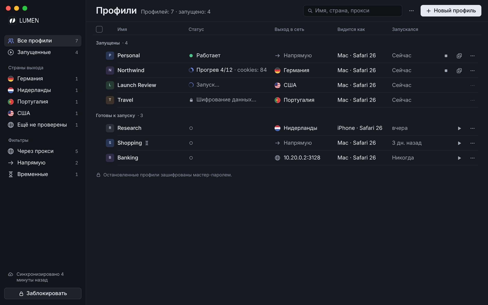
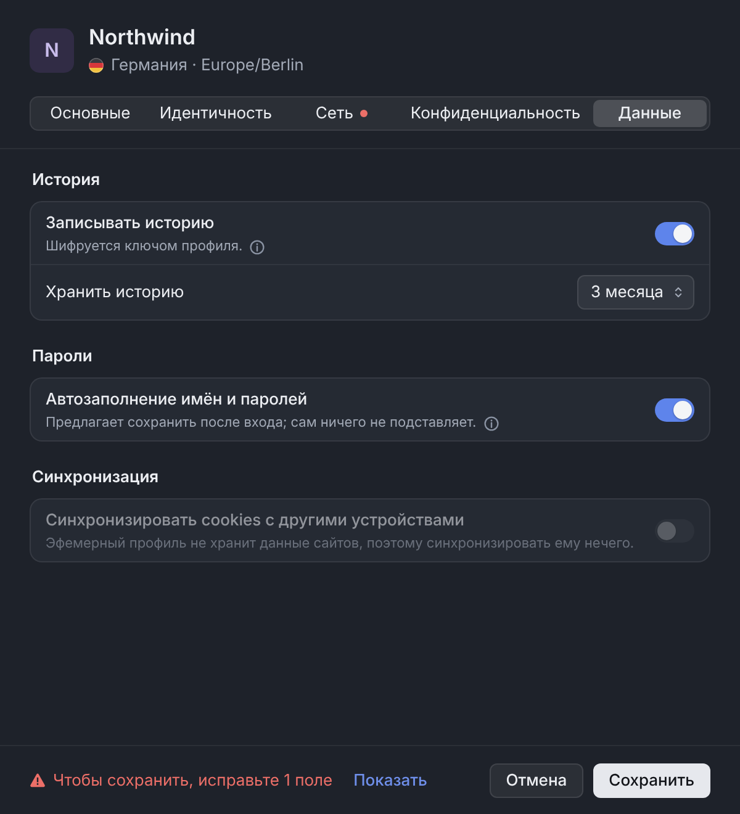
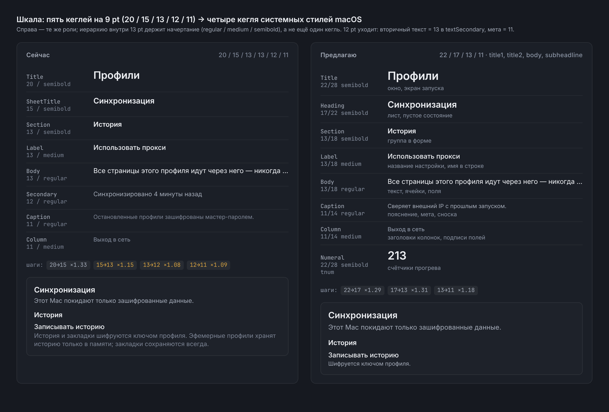
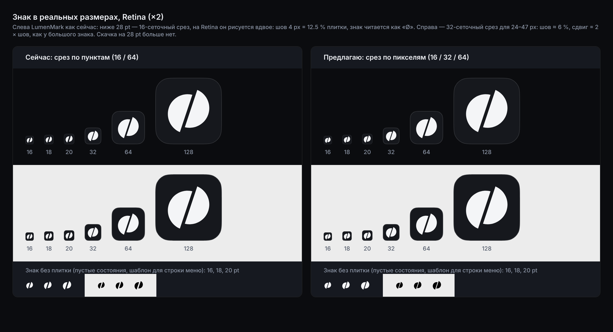
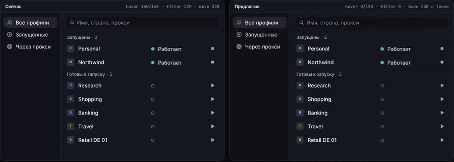
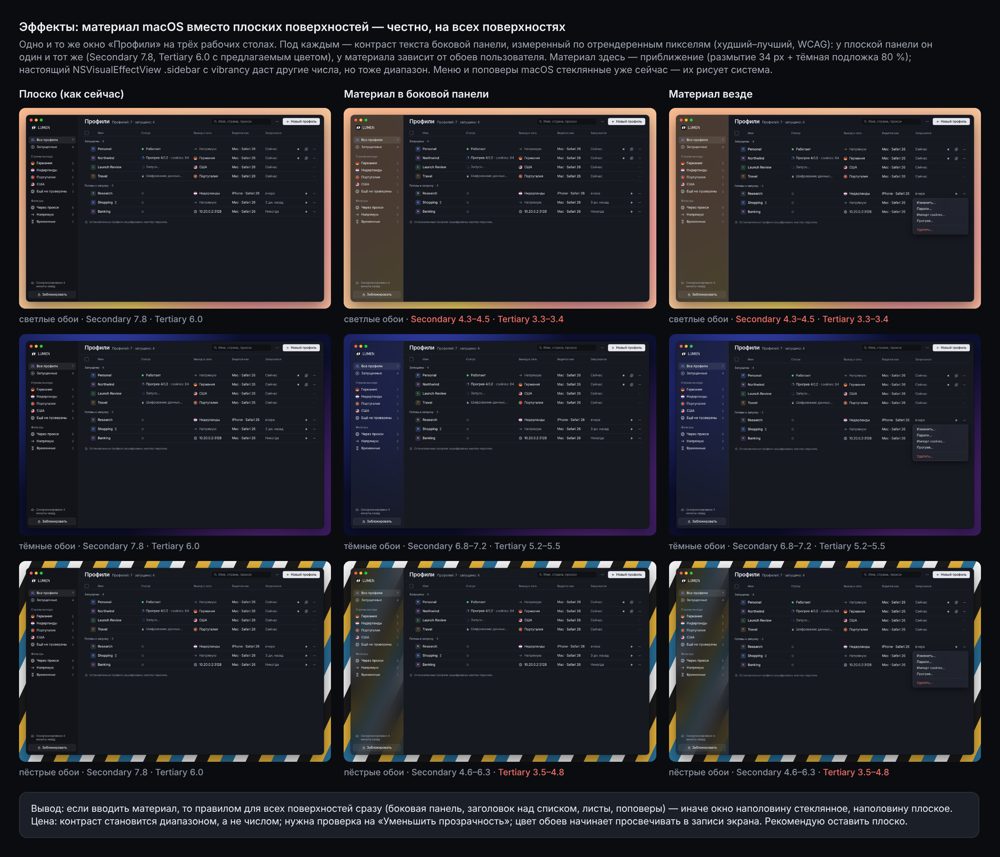
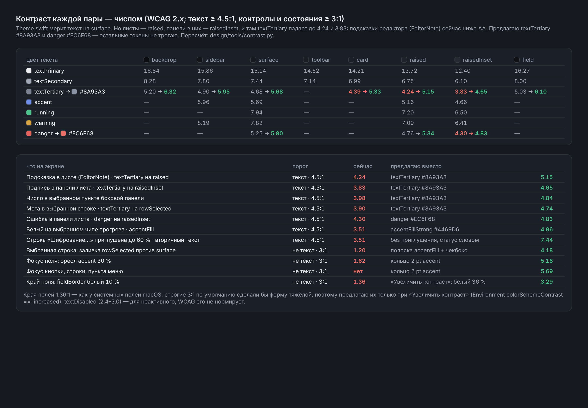

# Ревью дизайна Lumen

Визуальные предложения по интерфейсу PrivacyBrowser: что меняется, зачем, какие токены и файлы это затронет при внедрении и чего будет стоить. **В приложение ничего не внедрено.** В `Sources/`, `Resources/`, `scripts/`, `.github/` и `Package.swift` нет ни одной правки: всё, что здесь лежит, — прототипы, снимки и план. Реализация начнётся только после вашего «да», по каждому пункту отдельно.

## Как смотреть

- **Страница ревью:** `open design/review/index.html` после `git pull`. На ней всё: пары «до / после», ролики движения, вопросы, план. Переключатель RU/EN меняет язык интерфейса на снимках.
- **Живые прототипы** лежат в `design/prototypes/*.html` и открываются двойным кликом, сеть не нужна. На Mac они рисуются настоящим SF Pro. Сверху есть RU/EN, сценарии, Reduce Motion и «Новые строки» — эта кнопка обводит строки, которых в приложении ещё нет.
  - `profiles.html` — главный экран. Работают клики, выбор через ⌘ и ⇧, двойной клик и клавиши ↑↓ Space Return Esc ⌘A ⌘F.
  - `editor.html` — редактор профиля, все пять вкладок, ошибка в поле, ⓘ.
  - `settings.html` — окно «Настройки» и лист смены пароля.
  - `system.html` — шкалы, цифры, отступы, контраст, состояния, доступность.
  - `motion.html` — движение: «сейчас» и «предлагаю» рядом, с настоящими длительностями и кривыми.
- **Снимки «до».** CI на каждый push выкладывает экраны артефактом `ui-snapshots`. Скачать их мне не удалось: хост, где GitHub хранит артефакты (`productionresultssa7.blob.core.windows.net`), закрыт сетевой политикой окружения, в котором я работал. По памяти я их не рисовал. Достаточно одной команды в репозитории:

  ```bash
  gh run list --branch claude/secret-partner-setup-e505tc --limit 5
  gh run download <run-id> -n ui-snapshots -D design/shots/before
  ```

  После неё страница ревью сама поставит снимки слева в каждую пару: имена и размеры окон совпадают с `UISnapshots.swift`. Пока слева стоят заглушки.

## Коротко

| # | Предложение | Главный довод | Цена |
|---|---|---|---|
| 1 | Главный экран: строка 36 pt, колонка статуса, страны выхода, выбор пачкой | 16 строк на окне 1180 × 740 вместо 11; у каждого состояния своя форма знака | L |
| 2 | Не двигать строку из-под курсора | После ▶ строка переезжает в «Запущены», и под курсором оказывается ▶ соседнего профиля | M |
| 3 | Два цвета и один токен для контраста | Подсказки в листах сейчас 4.24:1 и 3.83:1, ниже AA | S |
| 4 | Шкала 22 / 17 / 13 / 11 и табличные цифры | Шесть ролей на пяти кеглях в 9 pt плюс 39 мест с системным `.caption` 10 pt | M |
| 5 | Окно «Настройки» и одна анатомия строки формы | Сейчас настройки в шести местах и с тремя видами строк, ошибка выводится не у своего поля | M |
| 6 | Знак: срез по пикселям; иконка слоями для macOS 26; монохром | На Retina 16–20 pt шов 12.5 % плитки, знак читается как «Ø» | S / L |
| 7 | Движение: ≤ 250 мс, Reduce Motion везде, фокус и выделение сразу | Список и вкладки сейчас не проверяют Reduce Motion | M |
| 8 | Эффекты: оставить плоско | С материалом контраст текста зависит от обоев: 3.3–6.0 вместо 6.0 | — |

Цена: **S** — до дня, **M** — несколько дней, **L** — неделя и больше или нужна проверка на Mac.

---

## 1. Главный экран



**Что меняется**

- Строка 36 pt с одной строкой текста вместо 48 pt с двумя: имя · статус · выход в сеть · видится как · запускался · действия. На окне 1180 × 740 целиком видно 16 строк вместо 11 (посчитано по рендеру и по метрикам `ProfilesScreen`).
- **Статус в своей колонке, и у каждого состояния свой знак:** ● работает · кольцо прогресса + «Прогрев 4/12 · cookies: 84» · вращающаяся дуга «Запуск…» · замок «Шифрование данных…» · ○ остановлен · ⚠ «Не запустился». Состояния отличаются формой, поэтому не держатся только на цвете. Строка при шифровании больше не тускнеет до 60 % (при этом вторичный текст падал до 3.51:1).
- **Действия иконками 28 × 28:** ▶ · ■ · новое окно · ⋯, с подсказками и `accessibilityLabel`. Колонка 92 pt вместо 236, освободившееся место получает имя. Двойной клик по строке запускает профиль.
- **Боковая панель:** раздел «Страны выхода» с флагами и счётчиками (данные уже есть, это `exitCountryCode`), фильтр «Напрямую». Поиск ищет ещё по стране, хосту прокси и устройству.
- **Выбор пачкой:** ⌘-клик и ⇧-клик, чекбоксы появляются при наведении и при выборе от двух строк. Заголовок окна превращается в панель «Выбрано: 4 · Запустить 3 · Остановить 1 · Прогрев… · ⋯ · Снять выделение».
- **Фильтры чипами** над списком: активный фильтр виден и снимается одним кликом.
- **Даты в таблице короткие** (`.relative(presentation: .numeric, unitsStyle: .abbreviated)`): «на прошлой неделе» (125 px) в колонку не помещается, «1 нед. назад» (78 px) помещается.
- **Ошибка запуска баннером** над списком с действием «Исправить прокси…» вместо модального алерта, плюс статус «Не запустился» в строке.

Остальные состояния: [узкое окно](shots/after/ru/profiles-narrow.png) · [фильтр](shots/after/ru/profiles-proxied.png) · [пусто](shots/after/ru/profiles-empty.png) · [нет совпадений](shots/after/ru/profiles-no-matches.png) · [пачкой](shots/after/ru/new-profiles-selection.png) · [60 профилей](shots/after/ru/new-profiles-scale.png) · [страна + фильтр](shots/after/ru/new-profiles-filtered.png) · [ошибка запуска](shots/after/ru/new-profiles-error.png) · [с клавиатуры](shots/after/ru/new-profiles-keyboard.png). Английский — те же имена в `shots/after/en/`.

**Что затронет внедрение.** `UI/ProfileListView.swift`:

- `ProfileRow` — колонка статуса вместо подзаголовка и иконки вместо текстовых кнопок;
- `ProfileColumns` — ширины 196 / 140 / 120 / 104 / 92 и новые пороги;
- `ProfilesSidebar` — раздел стран;
- `ProfilesScreen.header` — панель выбора и чипы;
- `ProfileFilter` — case `.direct` и страна;
- новые `StatusGlyph` (вместо `RunningDot`) и `LumenBanner`.

Для выбора нужно состояние `Set<UUID>` и клавиатура (`onKeyPress`, macOS 14). Сейчас список построен на `LazyVStack` и выбора не умеет. Пакетный прогрев и статус «Не запустился» требуют работы в `AppModel` и `ProfileManager`: см. вопрос 7.

**Цена: L.** Дороже всего выбор и клавиатура, и проверять их нужно руками на Mac. Альтернатива — SwiftUI `Table`: выбор и сортировка там бесплатные, но вид строк и заголовков контролировать труднее.

## 2. Формы и настройки



**Структура.** Настройки приложения, а не профиля, переезжают в окно «Настройки» (⌘,) с вкладками «Синхронизация», «WebRTC через прокси» и «Безопасность». Это стандартное место на Mac, как в Safari и Mail. Пункты меню «⋯» и строка синхронизации в боковой панели открывают нужную вкладку. Редактор профиля остаётся листом 600 × 660 с теми же пятью вкладками. Прогрев остаётся листом: это действие, а не настройка.

| Что | Где сейчас | Где предлагаю |
|---|---|---|
| Настройки профиля | Лист-редактор, свои `EditorToggle` / `EditorField` / `EditorRow` / `EditorNote` | Тот же лист; группы-карточки и одна строка `LumenSettingRow` |
| Синхронизация | Лист 540 (`SyncSettingsView`), системный `Form` | «Настройки» → «Синхронизация» |
| WebRTC через прокси | Лист 560 (`TunnelSettingsView`) | «Настройки» → «WebRTC через прокси» |
| Мастер-пароль | Лист 420 (`ChangePasswordView`) | «Настройки» → «Безопасность» → «Сменить…» |
| Перенос профиля между Mac | Экспорт — в меню строки, импорт — в «⋯»; листы 480 (`ProfileTransferViews`) | Остаются действиями: экспорт в меню строки, импорт в «⋯» и в меню «Файл»; листы S 440 с той же анатомией строки |

**Одна анатомия строки** для всех форм:

- название 13 pt medium, под ним **одна строка** пояснения 11 pt (`textSecondary`), контрол справа;
- для широкого контрола (меню устройства) — стек: контрол под текстом;
- длинный текст, который сейчас стоит абзацем, открывается по ⓘ во всплывающем окне;
- поля с подписью 11 pt medium над ними;
- ошибка выводится под своим полем: красная рамка и строка с ⚠. Во вкладке с ошибкой ставится точка, в подвале — «Чтобы сохранить, исправьте 1 поле · Показать»;
- на листе смены пароля правила проверяются прямо при вводе.

Снимки: [сеть](shots/after/ru/editor-network.png) · [сеть с ошибкой](shots/after/ru/new-editor-network-error.png) · [сеть целиком](shots/after/ru/new-editor-network-full.png) · [ⓘ](shots/after/ru/new-editor-details.png) · [новый профиль](shots/after/ru/editor-general-new.png) · [идентичность](shots/after/ru/editor-identity.png) · [конфиденциальность](shots/after/ru/editor-privacy.png) · [синхронизация](shots/after/ru/sheet-sync.png) · [WebRTC](shots/after/ru/new-settings-network.png) · [безопасность](shots/after/ru/new-settings-security.png) · [смена пароля](shots/after/ru/sheet-change-password.png).

**Что затронет внедрение.**

- `UI/ProfileEditorForm.swift` — `EditorField / EditorToggle / EditorRow / EditorNote / EditorGroupTitle / EditorDivider` заменяются общими `LumenSettingRow` и `LumenSettingGroup`, которые лучше положить в `SheetChrome.swift`.
- `ProfileDraft.makeConfiguration()` сейчас бросает одну `CoreError.invalidConfiguration(String)`. Для ошибки у поля нужен список ошибок по полям, например `func validate() -> [DraftField: String]`, а сообщения остаются те же.
- `App/PrivacyBrowserApp.swift` получает сцену `Settings { … }`. Тела `SyncSettingsView` и `TunnelSettingsView` переезжают туда без своих `SheetHeader / SheetFooter`.
- `VaultViews.ChangePasswordView` получает подписи над полями и правила.
- Около 40 новых строк, они перечислены ниже. Для «исправьте N полей» нужны формы множественного числа, то есть `Localizable.stringsdict`: сейчас в проекте только `.strings`.

**Цена: M.**

## 3. Типографика и общая система



**Шкала.** Сейчас шесть ролей стоят на пяти кеглях: 20 / 15 / 13 / 13 / 12 / 11, а шаги внизу всего ×1.08 и ×1.09. Кроме того, в коде **39 раз** стоит системный `.font(.caption)`, на macOS это **10 pt**, ниже нижней ступени. Он используется в `WarmUpView` (12 раз), `PasswordsView`, `CookieImportView` и `LibraryView` (по 6), `SyncSettingsView` (4), `TunnelSettingsView` (3), `VaultViews` и `ProfileTransferViews` (по 1). Ещё 32 места красят текст системным `.secondary` вместо `Theme.textSecondary`. Ещё 25 мест используют произвольный `.system(size:)`. Предлагаю четыре кегля системных стилей macOS:

| Роль | Сейчас | Предлагаю | Токен |
|---|---|---|---|
| Заголовок окна, экран запуска | 20 semibold | **22/28 semibold** (title1) | `Font.lumenTitle` |
| Заголовок листа, пустого состояния | 15 semibold | **17/22 semibold** (title2) | `Font.lumenHeading` — новый, вместо `lumenSheetTitle` |
| Группа в форме | 13 semibold | 13/18 semibold | `Font.lumenSection` |
| Название настройки, имя в строке | 13 medium | 13/18 medium | `Font.lumenLabel` |
| Текст, ячейки, поля | 13 | 13/18 | `Font.lumenBody` |
| Вторичный текст | 12 | **13 в `textSecondary`** | `lumenSecondary` уходит (54 места) |
| Пояснение, мета, сноска | 11 | 11/14 | `Font.lumenCaption`, вместо всех `.caption` |
| Заголовки колонок, подписи полей | 11 medium | 11/14 medium | `Font.lumenColumn` |
| Счётчики | 19 semibold | **22/28 semibold, tnum** | `Font.lumenNumeral` — новый |

Внутри 13 pt иерархию держит начертание, а не ещё один кегль. Межстрочный интервал задаётся через `.lineSpacing` (цель — 18 для 13 pt).

**Цифры.** Цифры, которые меняются на месте, — табличные: счётчики, «4/12», IP, порты, все колонки с числами. В SwiftUI это `.monospacedDigit()`, сейчас он стоит в 12 местах. Правило: везде, где число обновляется. [Снимок](shots/after/ru/new-system-numerals.png).

**Сетка и размеры.** [Снимок](shots/after/ru/new-system-metrics.png).

- Отступы 4 / 8 / 12 / 16 / 24 / 32 / 48. 6 допускается только между иконкой и подписью; 10, 14, 20 и 22 уходят.
- Одна высота контрола 28 pt: `lumenField` по умолчанию сейчас 32 при кнопках 28. 24 pt — для компактных кнопок в строках, 36 pt — для экрана запуска.
- Строки: список 36, боковая панель 28, строка формы не ниже 44. Заголовок окна 52, подвал листа 56 вместо 60.
- Три ширины листов вместо восьми (420, 480, 540, 560, 600, 680, 780, 880): **S 440 · M 600 · L 860**. Это новый `enum Theme.Sheet`.
- Скругления 6 и 10 и капсула; чипы прогрева 7 → 6.

**Состояния.** Один `LumenStateView` вместо `EmptyProfilesView`, `NoMatchesView`, `LumenEmptyHint` и голых `Text(…).foregroundStyle(.secondary)` в списках: знак или символ, заголовок 17, строка 13, действие. Ошибки, которые не мешают работать, показывает `LumenBanner` над содержимым, а не алерт. [Снимок](shots/after/ru/new-system-states.png).

**Цена: M.** Механическая, но затрагивает почти все вьюхи. Делать стоит одним проходом после того, как вы утвердите шкалу.

## 4. Знак и иконка



Идея остаётся прежней: диск, разрезанный крутым швом, половины сдвинуты вдоль шва и не касаются. Меняется исполнение.

- **Срез выбирается по пикселям, а не по пунктам.** Сейчас `LumenMarkGeometry.cut(forTileSize:)` берёт 16-сеточный срез ниже 28 pt. На Retina знак 16 pt рисуется в 32 px, то есть этот срез увеличен вдвое: шов 4 px, 12.5 % плитки (у большого знака 4.7 %), сдвиг половин почти пропадает, и знак читается как «Ø». Кроме того, на 27 → 28 pt шов скачет с 3.4 до 1.3 pt.
  - Предлагаю третий срез на 32-сетке (`r 10, gap 2, slide 4` — шов ≈ 6 %, сдвиг = 2 × шов, как у большого) для 24–47 px и выбор среза по `pt × displayScale` через `@Environment(\.displayScale)`.
  - На 1× остаётся 16-сетка, только сдвиг 2 → 2.5, чтобы половины читались сдвинутыми.
  - [Лупа ×8](shots/after/ru/new-logo-zoom.png).
- **`AppIcon.image(pixels:)`** выбирает срез по ширине плитки в пикселях: на иконке 16 pt @2x тоже получается 32-сетка.
- **macOS 26+.** Сейчас приложение рисует `.icns` само по сетке Big Sur (плитка 824/1024 с тенью). С macOS 26 иконку собирает система из слоёв Icon Composer: маска, стекло и режимы «Тёмный / Прозрачный / Тонированный». Слои лежат в `logo/macos26-layers/` — фон и две половины отдельно, все плоские, правило бренда соблюдено. Половины — разные слои, чтобы система могла развести их по глубине. [Лист](shots/after/ru/new-logo-macos26.png).
  - Внедрение: `.icon` в Icon Composer, `xcrun actool` в `scripts/build-app.sh` (Xcode 26), `CFBundleIconName` в `Info.plist`, `.icns` для macOS 14–15.
  - Настоящий рендер видно только на Mac: мои картинки режимов — приближения без стекла.
- **Монохром для строки меню.** Шаблонное изображение 16 / 18 pt: `logo/menubar-template-*.svg`. Значка в строке меню у приложения сейчас нет; этот вариант пригодится, если он появится (вопрос 7). [Лист](shots/after/ru/new-logo-menubar.png).
- **В системе:** Dock в тёмном и светлом режиме, Finder списком и значками, ⌘-Tab — [сейчас](shots/after/ru/new-logo-context-current.png) и [предлагаю](shots/after/ru/new-logo-context.png). Чужие иконки на макетах — нейтральные заглушки.

**Файлы.** `logo/*.svg` — знак текущий и уточнённый (16 / 32 / 64), голый знак, шаблоны, иконка 1024. `logo/png/{current,refined}/` — знак на 16, 18, 20, 32, 64, 128, 512 pt @2x на тёмной и светлой плитке, монохром, иконка 16–1024 px.

**Что затронет внедрение:** `UI/LumenMark.swift` (`LumenMarkGeometry`: срез `medium`, выбор по пикселям, `bareMedium`) и `App/AppIcon.swift`. **Цена: S.** Иконка macOS 26 — **L**: сборка и проверка на Mac.

## 5. Движение



Слева — как сейчас (те же длительности и кривые), справа — предложение. Ролики: [список](shots/motion/ru/list.mp4) · [список с Reduce Motion](shots/motion/ru/list-reduce-motion.mp4) · [вкладки листа](shots/motion/ru/sheet.mp4) · [экран запуска](shots/motion/ru/launch.mp4). Кривые лучше смотреть в `prototypes/motion.html`: ролик снят примерно с 25 кадрами в секунду.

**Находки в коде**

- `ProfileListView.swift:360` анимирует перестройку групп в момент смены статуса. Строка уезжает прямо из-под курсора, и через 0.6 с после ▶ под курсором оказывается ▶ соседнего профиля: второй клик запустит не тот профиль.
- Перестройка (`:360`), смена фильтра (`:339`, `:485`) и вкладки редактора (`ProfileEditorForm.swift:64`) не проверяют `accessibilityReduceMotion`. SwiftUI сам анимации не отключает; сейчас Reduce Motion учитывают только `LumenActivityLine` и `LockScreen`.
- Появление экрана запуска длится 60 + 420 мс, это дольше потолка 250 мс.

**Спек**

| Что | Сейчас | Предлагаю | Reduce Motion |
|---|---|---|---|
| Наведение (тон фона) | 160 мс easeOut туда и обратно | появление 0, угасание 120 мс easeOut | так же: это тон, а не движение |
| Нажатие | сразу 85 % | без изменений | — |
| Выделение строки, пункта, чипа | пункт панели 220 мс | сразу | — |
| Кольцо фокуса | у полей, 160 мс | у всех контролов, сразу | — |
| Результаты фильтра и поиска | 220 мс, строки едут | сразу | сразу |
| Статус строки | 160 мс | 120 мс, смена глифа и подписи | 120 мс, без движения |
| Строка между группами | сразу, 220 мс | когда курсор ушёл со списка, 220 мс | без анимации |
| Прогресс (полоска, кольцо) | 160 мс easeOut | 200 мс linear | сразу к значению |
| Счётчики, IP, «4/12» | сразу | сразу, табличные цифры | — |
| Вкладки листа | 220 мс наложения | сразу | сразу |
| Экран запуска | 60 + 420 мс, подъём 10 pt | 240 мс, подъём 6 pt | 150 мс проявление |
| Хранилище открывается | линия 1.4 с по кругу | так же, только пока ждём | сегмент стоит |
| Баннер ошибки | — | 180 мс + 6 pt сверху; уход 120 мс | только проявление |
| Листы, меню, поповеры, подсказки | системные | системные, не переопределять | система |

Никогда не анимируются выделение, фокус, текст и числа, сортировка и фильтр, раскладка при изменении размера окна и прокрутка. Ничего не пульсирует в покое.

**Что затронет внедрение.**

- `Theme.hoverAnimation` разделяется на появление (без анимации) и угасание (`.easeOut(duration: 0.12)`).
- `Theme.appearAnimation` остаётся только для перемещений.
- В `ProfilesScreen`, `ProfilesSidebar` и `ProfileEditorForm` появляется `@Environment(\.accessibilityReduceMotion)`.
- Отложенная перестройка: экран хранит «устоявшиеся» группы и обновляет их по `onHover(false)` списка.
- `LockScreen` получает новые числа.

**Цена: M.**

## 6. Эффекты



Правило бренда — без градиентов, свечений и блюра. Ниже проверено, что будет с материалом macOS (`NSVisualEffectView` / `.background(.material)`), причём честно, на всех поверхностях: боковая панель, заголовок над прокрученным списком, меню. Проверка шла на трёх обоях: светлых, тёмных и пёстрых. Контраст текста боковой панели я мерил по отрендеренным пикселям.

| Обои | Плоско (как сейчас) | Материал |
|---|---|---|
| светлые | Secondary 7.8, Tertiary 6.0 | Secondary 4.3–4.5, **Tertiary 3.3–3.4** |
| тёмные | 7.8, 6.0 | 6.8–7.2, 5.2–5.5 |
| пёстрые | 7.8, 6.0 | 4.6–6.3, **3.5–4.8** |

Материал здесь приближённый: размытие 34 px и тёмная подложка 80 %. Настоящий `.sidebar` с vibrancy даст другие числа, но тоже в виде диапазона. **Вывод:** если вводить материал, то правилом сразу для всех поверхностей, иначе окно получится наполовину стеклянным, наполовину плоским. Тогда контраст становится диапазоном, а не числом, нужна проверка с «Уменьшить прозрачность», и цвета обоев видны в записи экрана. Рекомендую оставить плоско. Системные меню и поповеры стеклянные уже сейчас: их рисует macOS.

## 7. Доступность



Контраст каждой пары посчитан скриптом `tools/contrast.py` по WCAG 2.x: для текста нужно ≥ 4.5:1, для контролов и состояний ≥ 3:1.

| Что на экране | Сейчас | Предлагаю вместо | Станет |
|---|---|---|---|
| Подсказка в листе (`EditorNote`): `textTertiary` на `raised` | **4.24** | `textTertiary` #8A93A3 | 5.15 |
| Подпись в панели листа: на `raisedInset` | **3.83** | #8A93A3 | 4.65 |
| Число в выбранном пункте боковой панели | **3.98** | #8A93A3 | 4.84 |
| Мета в выбранной строке | **3.90** | #8A93A3 | 4.74 |
| Ошибка в панели листа: `danger` на `raisedInset` | **4.30** | `danger` #EC6F68 | 4.83 |
| Белый на выбранном чипе прогрева: `accentFill` | **3.51** | новый `accentFillStrong` #4469D6 | 4.96 |
| Строка «Шифрование…» на 60 %: вторичный текст | **3.51** | без приглушения, статус словом | 7.44 |
| Выбранная строка: заливка против фона | **1.20** | полоска `accentFill` + чекбокс | 4.18 |
| Фокус поля: ореол 30 % | **1.62** | кольцо 2 pt `accent` | 5.16 |
| Фокус кнопки, строки, пункта панели | нет | кольцо 2 pt `accent` | 5.69 |
| Край поля: `fieldBorder` 10 % | **1.36** | при «Увеличить контраст» белый 36 % | 3.29 |

- Комментарий в `Theme.swift` говорит, что у `textPrimary` контраст 14.6:1. На `surface` он на самом деле 15.1:1, то есть устарел комментарий, а не цвет. Остальные значения (7.4 и 4.7) совпадают с записанными с точностью до округления.
- **Фокус с клавиатуры** сейчас виден только у полей. У `LumenButtonStyle`, `LumenIconButtonStyle`, строк, пунктов боковой панели и чипов его нет. Предлагаю кольцо 2 pt `accent` с отступом 1 pt, без анимации.
- **Мишени ≥ 24 × 24.** Сейчас меньше у очистки поиска (12 × 12, `LumenSearchField`) и у копирования и показа пароля (около 16, `PasswordsView`).
- **Статус не только цветом.** У каждого состояния своя форма; на [листе доступности](shots/after/ru/new-system-a11y.png) это проверено с имитацией дейтеранопии и в оттенках серого.
- **Края полей.** Строгие 3:1 по умолчанию сделали бы формы тяжёлыми; системные поля macOS дают примерно столько же, сколько у нас сейчас. Поэтому 3:1 предлагаю только при «Увеличить контраст»: `@Environment(\.colorSchemeContrast) == .increased`.

**Что затронет внедрение:** `Theme.textTertiary`, `Theme.danger`, новый `Theme.accentFillStrong`, их копии в `Theme.NS`; чипы в `WarmUpView`; `ProfileRow` без `.opacity(0.6)`; фокус в стилях кнопок. **Цена: S** для цветов, **M** для фокуса.

---

## Где прототип расходится с приложением

- **Шрифт.** PNG сняты в Chromium на Linux, и вместо SF Pro там Inter. Inter по ширине близок к SF Pro, но насколько именно, на Linux не проверить; поэтому колонки я брал с запасом, а окончательно ширины русских строк видно только в Safari на Mac, где прототип рисуется настоящим SF. Свой tracking SF применяет сам, веб — нет.
- **Нативные контролы.** Сегменты, переключатели, всплывающие меню, меню и поповеры — рисованные копии AppKit. Высоты, радиусы и тени у настоящих немного другие.
- **Значки** — копии SF Symbols на 16-сетке. В приложении остаются настоящие символы с теми же именами (`person.2`, `play.circle`, `network`, `hourglass`, `lock` …).
- **Знак и иконку растеризует Skia, приложение — Core Graphics.** На 16–20 px край может отличаться оттенком, но не формой. Режимы иконки macOS 26 нарисованы без стекла.
- **Дорогое при внедрении.** Выбор пачкой и клавиатура на `LazyVStack` пишутся руками, а `Table` даёт их бесплатно, но меньше контроля над видом. Отложенная перестройка групп требует хранить «устоявшийся» порядок отдельно от живого статуса. Ошибки по полям требуют, чтобы `ProfileDraft` возвращал их по полям, а не одной строкой.
- **Даты в таблице.** Формат «3 дн. назад» я подставил по известным мне формам ICU; точную строку даст `Date.FormatStyle` на Mac.
- **Материал** — приближение `backdrop-filter`, не `NSVisualEffectView`.

## Вопросы к вам

С картинками и вариантами они собраны на странице ревью, раздел «Вопросы»: там можно выбрать ответы и скопировать их в чат одной кнопкой. Здесь коротко, рекомендуемый вариант первым.

1. **Плотность строк:** 36 pt (рекомендую) или 32 pt (на 2 строки больше, кнопки 24 × 24)? — [36](shots/after/ru/new-profiles-scale.png) · [32](shots/after/ru/new-profiles-scale-row32.png)
2. **Группы «Запущены / Готовы» с перестройкой после ухода курсора** (рекомендую) или плоский список с сортировкой по статусу? — [группы](shots/after/ru/new-profiles-scale.png) · [плоский](shots/after/ru/new-profiles-scale-flat.png)
3. **Окно «Настройки» (⌘,)** (рекомендую) или оставить листы из «⋯» и привести только вид строк?
4. **Знак: срез по пикселям 16 / 32 / 64** (рекомендую) или оставить как есть? — [лупа](shots/after/ru/new-logo-zoom.png)
5. **Иконка слоями для macOS 26:** сейчас, после остального (рекомендую) или нет?
6. **Эффекты:** оставить плоско (рекомендую) или материал правилом на всех поверхностях?
7. **Что добавить из нового** (это работа в модели, а не только во вьюхах): пакетный прогрев · статус «Не запустился» в строке · значок в строке меню.

## Новые строки

Этих строк в `Resources/{ru,en}.lproj/Localizable.strings` пока нет. Прототипы помечают их пунктиром по кнопке «Новые строки». Остальные строки, которые показывают прототипы, совпадают с приложением слово в слово; это проверяет `node design/tools/check-strings.cjs`: 167 существующих, 46 новых.

| Ключ | RU | EN |
|---|---|---|
| `profiles.column.status` | Статус | Status |
| `profiles.status.stopped` | Остановлен | Stopped |
| `profiles.status.failed` | Не запустился | Didn’t start |
| `profiles.countries` | Страны выхода | Exit countries |
| `profiles.countries.unknown` | Ещё не проверены | Not checked yet |
| `profiles.search.prompt` | Имя, страна, прокси | Name, country, proxy |
| `profiles.selection.count` | Выбрано: %ld | %ld selected |
| `profiles.selection.launch` | Запустить %ld | Launch %ld |
| `profiles.selection.stop` | Остановить %ld | Stop %ld |
| `profiles.selection.clear` | Снять выделение | Deselect All |
| `profiles.filter.clearAll` | Сбросить фильтры | Clear Filters |
| `profiles.banner.didNotStart` | Профиль «%@» не запустился: адрес прокси неверный. | “%@” didn’t start: its proxy address is not valid. |
| `profiles.banner.fix` | Исправить прокси… | Edit Proxy… |
| `profiles.noMatches.hint` | По запросу «%@» с этими фильтрами ничего нет. | Nothing matches “%@” with these filters. |
| `common.details` | Подробнее | Details |
| `settings.tab.security` | Безопасность | Security |
| `settings.security.password` | Мастер-пароль | Master password |
| `settings.security.password.hint` | Шифрует хранилище; восстановить его нельзя. | Encrypts the vault; it cannot be recovered. |
| `settings.security.change` | Сменить… | Change… |
| `settings.security.lock` | Заблокировать сейчас | Lock now |
| `settings.security.lock.hint` | Останавливает все профили и забывает ключи. | Stops all profiles and forgets all keys. |
| `settings.window.hint` | Настройки приложения на этом Mac; настройки профиля — в его редакторе. | Settings of this Mac’s app; a profile’s own settings stay in its editor. |
| `sync.to.hint` | Этот Mac покидают только зашифрованные данные. | Only encrypted data leaves this Mac. |
| `sync.folder.hint` | Одна папка на хранилище: сетевой диск или накопитель. | One folder per vault: a NAS share or a disk. |
| `sync.whatSyncs` | Что синхронизируется и что видно месту хранения | What syncs, and what the location can see |
| `tunnel.hint` | Пропускает WebRTC профилей с SOCKS5 через их прокси. | Carries the WebRTC of SOCKS5 profiles through their proxy. |
| `tunnel.limits.title` | Ограничения | Limits |
| `changepw.rule.ok` | Не менее 10 символов | At least 10 characters |
| `editor.group.proxy` | Прокси | Proxy |
| `editor.group.webrtc` | WebRTC | WebRTC |
| `editor.proxy.type.hint` | Только SOCKS5 может нести и WebRTC. | SOCKS5 can also carry WebRTC. |
| `editor.proxy.warnIPChange.hint` | Сверяет внешний IP с прошлым запуском. | Compares the exit IP with the previous launch. |
| `editor.proxy.bypass.hint` | Эти домены открываются без прокси. | These domains open without the proxy. |
| `editor.webrtc.hint.off` | Отключён: сетевое расширение выключено. | Off: the network extension is off. |
| `editor.tz.follow.hint` | Профиль живёт по часовому поясу места выхода. | The profile runs in the time zone of its exit. |
| `editor.generation.hint` | Задаёт заявляемый User-Agent; движок остаётся WebKit этого Mac. | Sets the declared User-Agent; the engine stays this Mac’s WebKit. |
| `editor.ua.hint` | Заменяет User-Agent, заданный устройством выше. | Replaces the User-Agent the device above sets. |
| `editor.geo.hint` | Что получит сайт, когда спросит местоположение. | What a site gets when it asks for your location. |
| `editor.tz.override.hint` | Иначе — пояс места выхода прокси. | Otherwise the time zone of the proxy’s exit. |
| `editor.safeBrowsing.hint` | Предупреждает о фишинговых и вредоносных страницах. | Warns about phishing and malware pages. |
| `editor.history.record.hint` | Шифруется ключом профиля. | Encrypted with the profile key. |
| `editor.passwords.autoFill.hint` | Предлагает сохранить после входа; сам ничего не подставляет. | Offers to save after a sign-in; never fills by itself. |
| `editor.sync.cookies.hint` | Постоянные cookies, по одному; побеждает более новое. | Persistent cookies, merged one by one; the newer wins. |
| `editor.errors.count` | Чтобы сохранить, исправьте 1 поле | Fix 1 field to save |
| `editor.errors.show` | Показать | Show |
| `editor.tab.hasError` | В этом разделе есть поле с ошибкой | This section has a field to fix |

`editor.errors.count` в приложении нужна с числом и формами множественного числа (1 поле, 2 поля, 5 полей), то есть через `Localizable.stringsdict`.

## Что лежит в `design/`

```text
design/
  README.md                этот файл
  review/index.html        страница ревью (откройте её первой)
  prototypes/              интерактивные HTML-прототипы; kit/ — токены, строки, знак, флаги, значки
  shots/after/{ru,en}/     снимки прототипов: Retina ×2, размеры окон как в UISnapshots.swift;
                           имена совпадают со снимками CI, у новых экранов префикс new-
  shots/before/{ru,en}/    сюда кладутся снимки CI (gh run download …), пока пусто
  shots/motion/{ru,en}/    ролики «сейчас | предлагаю» (MP4; список на русском ещё и GIF)
  logo/                    SVG знака, иконки, шаблонов; слои macOS 26; PNG в реальных размерах
  tools/                   чем всё это собрано
```

## Как пересобрать

Нужны Node 22 и Playwright с Chromium, а для роликов ещё ffmpeg. Сеть не нужна: рендер обрывает любой запрос не к `file://`.

```bash
node design/tools/render.mjs            # снимки прототипов (или: render.mjs profiles)
node design/tools/logo.mjs              # знак, иконка, листы знака
node design/tools/record.mjs            # ролики движения
node design/tools/effects.mjs           # сравнение материалов и замер контраста
python3 design/tools/contrast.py        # таблицы контраста (+ kit/contrast-data.js)
node design/tools/check-strings.cjs     # строки прототипов против Localizable.strings
node design/tools/extract-wordmark.mjs  # логотип-надпись из LumenMark.swift
```
