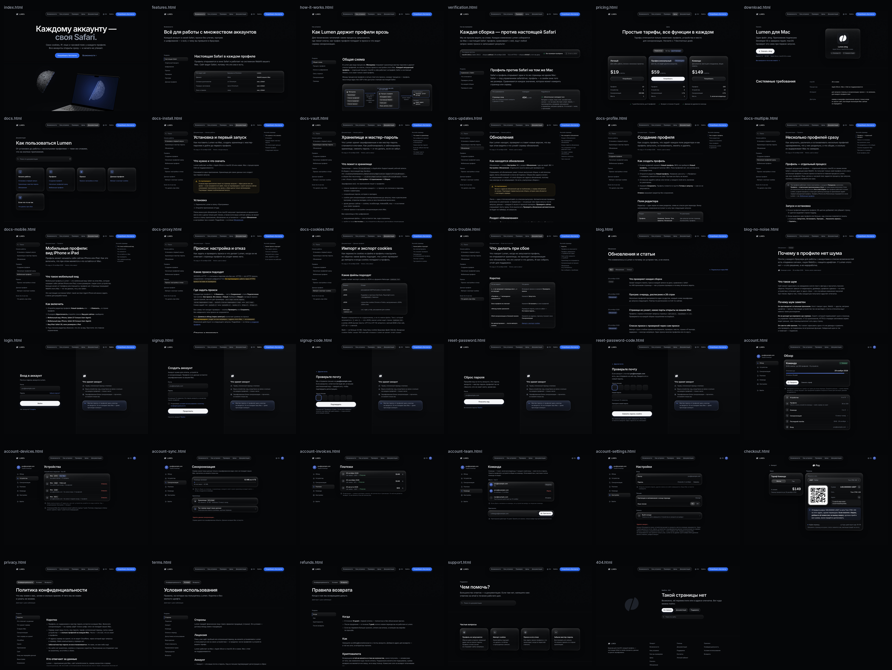

# Сайт: дизайн и прототип

Дизайн сайта продукта: макеты всех страниц, кликабельный прототип, тексты на двух языках и спецификация. **Сайт не разрабатывается и не деплоится**: бэкенда нет, формы никуда не отправляют, поиск не ищет. Всё лежит в `design/site/` и живёт в отдельной ветке **`claude/site-prototype`** — только сайт (рекламный ролик — в ветке `claude/site-design`), коммиты с `[skip ci]`, чтобы не запускать CI продукта. В `Sources/`, `Resources/`, `scripts/`, `.github/` и `Package.swift` нет ни одной правки, и вне `design/site/` ветка ничего не добавляет: знак, флаги и иконки — копия `design/prototypes/kit` в `tools/lib/kit`.

Название — **Lumen**, домен — **lumenbrowser.io** (решения владельца; меняются одной строкой в `tools/build.mjs`). Юрлица нет: сторона на сайте везде называется Lumen, реквизитов компании нет.



## Как смотреть

- **Получить:** `git fetch origin claude/site-prototype && git checkout claude/site-prototype` (или `git pull`, если ветка уже открыта).
- **Артефакт (смотреть в браузере):** https://claude.ai/artifact/FgdhKWfLq11eu8qCj1MaWe — вся папка `prototype/` (главная страница — `index.html`, обзор). Владелец смотрит сайт здесь: после каждого изменения сайта артефакт обновляется по этой же ссылке — сборка, проверка, затем публикация всех файлов `prototype/`, которые есть в git (удалённые страницы снимаются из артефакта).
- **Обзор прототипа:** `design/site/prototype/index.html` — все страницы на русском и английском, снимки, ролики движения, решения владельца и открытые вопросы с кнопкой «Скопировать ответы». Открывается с диска двойным кликом, сеть не нужна. На Mac страницы рисуются настоящим SF Pro.
- **Панель прототипа** внизу каждой страницы: язык, «Отметки решений» (по умолчанию выключены, как на настоящем сайте; включённые подсвечивают жёлтым то, что решаете вы) и «Без движения» (как системное «Уменьшить движение»). На настоящем сайте её не будет.
- **Переходы между страницами** браузер делает только для страниц с сервера: `cd design/site/prototype && python3 -m http.server 8000` → `http://localhost:8000`. Остальное работает и с диска.
- **Снимки:** `shots/{ru,en}/<страница>-{1440,390}.png` — страница целиком, Retina ×2; обзорные листы — `shots/overview-{ru,en}-{1440,390}.png`.
- **Движение:** `shots/motion/*.mp4`, девять роликов (главное — `home-1440.mp4` и `home-390.mp4`: главная целиком); их список с пояснениями — на странице обзора. Главная — презентация, она живёт прокруткой, поэтому её лучше листать в самом прототипе: снимки показывают каждую сцену уже в итоговом виде.
- **Рекламный ролик:** `video/lumen-ru.mp4` и `video/lumen-en.mp4` — 30 секунд, 1080p, 60 кадров в секунду, со звуком; что в нём и как он собран — [`video/README.md`](video/README.md).
- **Тексты:** `copy/{ru,en}/*.md` — всё, что написано на каждой странице, для чтения; правятся исходники `copy/source/{ru,en}/*.mjs` (тексты главной — по файлу на сцену, `home-<сцена>.mjs`).
- **Спецификация:** [`spec.md`](spec.md) — токены, контраст, типографика, сетка, компоненты, движение с длительностями.

## Что спроектировано

24 страницы, каждая — на русском и английском, в ширинах 1440 и 390: 96 снимков.

| Страница | Что на ней | Снимок |
|---|---|---|
| Главная | Презентация из одиннадцати сцен, у каждой свой приём. Вступление: «Каждому аккаунту — своя Safari», MacBook Pro, на экране знак Lumen из символов кода, левая половина выходит к нам. Манифест по словам. «Все профили — сразу»: одно окно Safari раскрывается во все профили, как Mission Control. «Каждый профиль — из своей страны»: один сайт в Германии, США и Японии. «Взрыв-схема» профиля: окно, процесс, данные, сеть, ключ. «Прокси упал — соединения нет»: загрузка замирает, свет гаснет, Safari показывает ошибку. «Не прочитаем даже мы»: луч шифрует данные профиля, шифр складывается в замок из кода; AES-256-GCM и Argon2id. «Прогрев — пока вы работаете»: скрытое окно за рифлёным стеклом идёт по шведским сайтам. «Lumen в цифрах»: 448, 31 из 31, 15 из 15, 0, 26 над макро дисплея. Бенто «всё, к чему вы привыкли в Safari» и призыв | [1440](shots/ru/index-1440.png) · [390](shots/ru/index-390.png) |
| Возможности | Подробности, которые ушли с главной: семь блоков с навигацией по разделам (Safari и таблица «браузер на Chromium / Lumen», процесс на профиль, шифрование, прокси с живым переключателем «прокси упал», проверка — с тем, почему в профиле нет шума, и ссылкой на статью, прогрев, данные профиля), два частых вопроса | [1440](shots/ru/features-1440.png) · [390](shots/ru/features-390.png) |
| Как устроено | Для технических читателей: схема процессов, процесс профиля, иерархия ключей, сеть и прокси (каждый канал — как закрыт и чем проверяется), синхронизация, границы | [1440](shots/ru/how-it-works-1440.png) · [390](shots/ru/how-it-works-390.png) |
| Как мы проверяем | Сравнение с Safari на том же Mac, все 14 отличий с причинами, проверки утечек, что проверяется на каждой сборке, как проверить самому, отчёты | [1440](shots/ru/verification-1440.png) · [390](shots/ru/verification-390.png) |
| Цены | Три тарифа ($19 / $59 / $149, год — цена 10 месяцев), что входит во все, оплата криптовалютой, что будет по окончании периода, возвраты, пять вопросов (пробный период — в заголовке и строке под тарифами) | [1440](shots/ru/pricing-1440.png) · [390](shots/ru/pricing-390.png) |
| Скачать | Требования, установка, подпись и контрольная сумма (команды проверки — под «Проверить в Терминале») | [1440](shots/ru/download-1440.png) · [390](shots/ru/download-390.png) |
| Документация | Оглавление и девять статей по коду браузера и измерениям: установка, хранилище и мастер-пароль, обновления, создание профиля, несколько профилей сразу, мобильные профили, прокси и его отказ, cookies, что делать при сбое. Где поведение не подтверждено — жёлтая отметка «Не подтверждено» | [1440](shots/ru/docs-1440.png) · [390](shots/ru/docs-390.png) |
| Обновления | Шаблон списка: фильтр, дата, тип, анонс | [1440](shots/ru/blog-1440.png) · [390](shots/ru/blog-390.png) |
| Обновления — запись | Шаблон записи. Образец — статья «Почему в профиле нет шума» | [1440](shots/ru/blog-no-noise-1440.png) · [390](shots/ru/blog-no-noise-390.png) |
| Вход по email | Одноразовый код; рядом — что хранит аккаунт и «мастер-пароль здесь не вводится» | [1440](shots/ru/login-1440.png) · [390](shots/ru/login-390.png) |
| Вход: код | Шесть ячеек, «отправить ещё раз» без таймера | [1440](shots/ru/login-code-1440.png) · [390](shots/ru/login-code-390.png) |
| Вход по ключу | Лицензионный ключ без email и честное предупреждение: потерян — не восстановить | [1440](shots/ru/login-key-1440.png) · [390](shots/ru/login-key-390.png) |
| Регистрация | С email или без email (оплата криптовалютой → ключ) | [1440](shots/ru/signup-1440.png) · [390](shots/ru/signup-390.png) |
| Кабинет: обзор | Тариф и «оплачено до» с полосой оставшегося срока, одна кнопка «Продлить» (месяц или год — на оплате), строки Mac / синхронизация / последний платёж / вход. На телефоне — плавающая панель вкладок | [1440](shots/ru/account-1440.png) · [390](shots/ru/account-390.png) |
| Кабинет: Mac и синхронизация | Mac по коду устройства, отзыв; ровно то, что видит сервер: непрозрачные объекты и размеры — свёрнуто в одну строку «Так сервер видит ваши данные» | [1440](shots/ru/account-devices-1440.png) · [390](shots/ru/account-devices-390.png) |
| Кабинет: платежи | Платежи списком: дата, номер, монета, сумма, квитанция PDF | [1440](shots/ru/account-invoices-1440.png) · [390](shots/ru/account-invoices-390.png) |
| Кабинет: настройки | Вход, письма, сеансы (на телефоне — «Выйти»), внизу редкое: переход на ключ и удаление аккаунта | [1440](shots/ru/account-settings-1440.png) · [390](shots/ru/account-settings-390.png) |
| Оплата (Lumen Pay) | Своя страница оплаты криптовалютой под маркой Lumen Pay, устроена как обычная оплата: «Заказ» (тариф, месяц или год, сумма, срок) и «Перевод» (монета списком с поиском, QR-код, сумма и адрес с кнопками копирования, сеть, статус и таймер); на компьютере рядом, на телефоне друг за другом | [1440](shots/ru/checkout-1440.png) · [390](shots/ru/checkout-390.png) |
| Конфиденциальность | С разделом «Что сервер о вас знает» и прямо: данные профилей сервер расшифровать не может, забытый мастер-пароль не восстанавливается | [1440](shots/ru/privacy-1440.png) · [390](shots/ru/privacy-390.png) |
| Условия | Лицензия, аккаунт, подписка, допустимое использование, ответственность, право | [1440](shots/ru/terms-1440.png) · [390](shots/ru/terms-390.png) |
| Возвраты | Когда, как, криптовалюта, что после | [1440](shots/ru/refunds-1440.png) · [390](shots/ru/refunds-390.png) |
| Поддержка и контакты | Частые вопросы, форма, «никогда не присылайте мастер-пароль», адреса | [1440](shots/ru/support-1440.png) · [390](shots/ru/support-390.png) |
| 404 | Знак, три пути дальше, поиск | [1440](shots/ru/404-1440.png) · [390](shots/ru/404-390.png) |

Английские снимки — те же имена в `shots/en/`.

## Решения и почему

1. **Главная — презентация, как у Apple, и приёмы разные.** По вашим отзывам и присланным примерам с apple.com: каждая сцена закрепляется, пока играет, и движется вместе с прокруткой, но приём у каждой свой — продуктовый рендер, манифест по словам (один раз), Mission Control, сайт, который перестраивается под страну, «взрыв-схема», окно, которое гаснет, луч и замок из кода, рифлёное стекло, цифры над макро, бенто. Сцен стало одиннадцать: добавлены «Все профили — сразу», «Прокси упал» (вместо схемы с лучом) и «Не прочитаем даже мы» — шифрование. Заголовки двухтонные: белый и серый. Подробности, таблицы и схемы — на «Возможностях», «Как устроено» и «Как мы проверяем».
2. **Вступление — ваша идея с MacBook.** Прошлый Mac был собран из CSS-блоков и выглядел игрушечным. Теперь MacBook Pro в цвете Space Black отрендерен заранее, со светом, отражениями и тенями (`tools/hero/`), и прокручивается кадрами на `<canvas>` — так делает сама Apple. На его экране знак Lumen из символов кода: две половины — два профиля со своими данными (de-DE · Europe/Berlin и en-US · America/New_York), между ними шов света. При прокрутке камера подходит ближе и обходит Mac, левая половина выходит из экрана к нам. Плашки и галочки под заголовком убраны. Черепа и «хакерских» образов нет сознательно: для платёжных провайдеров это красный флаг, а позиционирование — приватность и несколько аккаунтов.
3. **Цвет — сдержанно и только свой.** Палитра главной — чёрный, белый, серые и один синий бренда (`#2F6BEF` и его оттенки); пастельных и «новых» цветов больше нет, градиентов в тексте тоже. Синий в тексте — только в манифесте, на двух фразах. Цвет есть там, где он — часть картинки: сайты в окнах профилей, флаги, субпиксели в «цифрах». Само по себе ничего не движется и не мигает: всё движение идёт от прокрутки.
4. **Стекло и шапка.** На компьютере: логотип слева, разделы — в стеклянной капсуле посередине, справа язык, «Войти» и синяя капсула «Попробовать бесплатно»; вверху страницы шапка прозрачная, при прокрутке под ней появляется полоса стекла (как край прокрутки в macOS 26). На телефоне — как продуктовая полоса Apple: имя, под ним раздел, в котором вы сейчас (меняется при прокрутке), стрелка к разделам и синяя кнопка; меню — стеклянная панель. Приложение остаётся плоским: токены из `Theme.swift`, знак и надпись — из `LumenMark.swift`; стекло и свечение есть только на сайте. Отступлений в цвете три: фон страницы на тон глубже (`#060709` вместо `#0B0C0F` — на нём читаются код и стекло), `textTertiary` `#8A93A3` и `danger` `#EC6F68` из ревью дизайна приложения. Контраст всех 51 пары, включая текст на стекле, — в `spec.md`.
5. **Остальные страницы — спокойные и информативные.** Таблица «браузер на Chromium / Lumen», схемы, прогрев, вопросы — на «Возможностях», «Как устроено» и «Как мы проверяем». Рисунки приложения там — на тех же токенах и с теми же строками, что в приложении (`Localizable.strings`), данные — образцы из `UISnapshots.swift`. На телефоне таблицы складываются в карточки «подпись над значением».
6. **Главный аргумент — измерение, и оно показано целиком.** Страница «Как мы проверяем» публикует не только «434 из 448», но и все 14 отличий с причинами, разделив их на «в продукте» (6: Apple Pay и Web Push) и «на стенде» (8: язык самотеста, скрытое окно, webdriver). Открытый список отличий убеждает сильнее, чем «100 %».
7. **Без шума — объяснено, а не заявлено.** Три довода: шум противоречит остальным признакам, не доходит до сервера (TLS, HTTP/2, заголовки), а совпадение можно проверить. И честная граница: признаки железа у профилей на одном Mac общие, как у вкладок одной Safari, — профили различаются хранилищем, сетью, языком и часовым поясом. Если такая откровенность на сайте лишняя, её легко убрать, но я бы оставил: покупатель всё равно это узнает.
8. **Позиционирование — приватность и несколько аккаунтов.** Ни слова про обход проверок личности, верификаций и антифрода, слова «антидетект» тоже нет (вопрос 5). В условиях — запрет мошенничества и выдачи себя за другого, а правила сторонних сайтов соблюдает пользователь. `tools/check.mjs` ловит запрещённые формулировки.
9. **Кабинет показывает только то, что знает сервер.** Имён профилей и их числа сервер не знает — по устройству синхронизации, поэтому «профили в синхронизации» — это непрозрачные объекты, размеры и время (вопрос 6). Устройства — по коду, а не по имени: имён Mac сервер тоже не знает. Лимит профилей проверяет приложение, и кабинет подаёт это как доказательство главного обещания, а не как ограничение.
10. **Вход по ключу без email** — для тех, кому не нужен даже email; с честным предупреждением, что потерянный ключ не восстановить.
11. **Все защиты — в каждом тарифе.** Тарифы различаются профилями и Mac, а не безопасностью; сколько профилей работают одновременно, не ограничено ни на одном тарифе. Метка у среднего тарифа — «Рекомендуем», а не «Чаще выбирают»: второе было бы выдумкой.
12. **На сайте нет аналитики** и сторонних скриптов, cookie одна — сеанс кабинета. Это записано в подвале и в политике, то есть обязывает и настоящий сайт.
13. **Движение — от прокрутки.** Сцены главной играют вместе с прокруткой и останавливаются, когда она останавливается; на других страницах — появление при прокрутке (240 мс), индикатор раздела (200 мс), смена страниц (200 мс). Ничего не пульсирует. С Reduce Motion и без JavaScript сцен нет: каждая секция сразу показывает итоговую картинку (вместо знака из кода — обычный знак).
14. **Тексты отдельно от вёрстки.** Страницы собираются из `copy/source/{ru,en}` и шаблонов `tools/templates`; читабельные `copy/{ru,en}/*.md` выгружаются из готовых страниц, поэтому тексты и прототип не расходятся. `tools/check.mjs` следит, чтобы у русского и английского были одни и те же ключи.

## Цифры: откуда каждая

Правило брифа — «любая цифра либо правда из репозитория, либо её нет» — проверяется машиной: `copy/facts.mjs` перечисляет каждую цифру сайта с источником, `tools/check.mjs` падает на любой другой. Не считаются только значения, которые решаете вы (жёлтые), образцы данных в макетах (`data-sample`) и код.

Что важно знать о главных цифрах:

- **448 — это признаки страницы-зонда**, сравниваемые с настоящей Safari: в последнем зелёном прогоне CI (#388, коммит `ce64ca1`) — «434 keys identical, 14 differ (reported), 0 must-match keys differ». **TLS и заголовки в эти 448 не входят** — они сравниваются отдельно и сверх них: заголовки запросов 31 из 31, TLS и HTTP/2 15 из 15. В брифе было «по 448 признакам, включая TLS-рукопожатие и порядок HTTP-заголовков» — на сайте я написал, как есть: «448 признаков страницы, заголовки, TLS и HTTP/2».
- **TLS 15 из 15 — из прогона #385** (`d1d1db7`, тот же день). В #388 сервис tls.peet.ws не ответил Safari («JSON Parse error»), и TLS не сравнивался — сравнение «report only» и сборку не роняет. Сайт так и подписывает строку. Это стоит починить до запуска, чтобы цифра бралась из последнего прогона.
- **Самотест 274 проверки, модульных тестов 223, 2 410 пакетов, трасса 606 017 строк** — прогон #388. Это меняется с каждой сборкой: на настоящем сайте цифры должны подставляться из отчёта выпуска (вопрос 7).
- **Остальное** — из кода и документации: Argon2id 64 МиБ / 3 прохода / 4 потока, 26 стран прогрева, 4–12 / 10–35 / 25–90 с на странице, 52 и 90 px панели Safari, macOS 14 из `Info.plist`, 32 МБ для файла cookies, 10 символов мастер-пароля, 10 минут до новой попытки прогрева.

## Что я сознательно не показал

Бриф: «не перечисляй то, что ещё в работе, и не заявляй готовым то, чего нет».

- **WebRTC через SOCKS5-прокси** (пакетный туннель): нужна платная команда Apple Developer, и расширение ещё не запускалось на настоящем Mac. На сайте — честное «в профиле с прокси WebRTC выключен».
- **Профили iPhone и iPad**: меняют только User-Agent, железо остаётся Mac. Показывать это возможностью — значит обещать больше, чем есть.
- **Локальный API автоматизации и `pbctl`**: есть и проверяется самотестом, но в брифе его нет. Могу добавить блок в «Возможности» и раздел в документацию — скажите.
- **Сборка с App Sandbox**: сайт описывает сборку с окном Safari и процессом на профиль; о песочнице App Sandbox на сайте ни слова.

## Что сайт обещает от продукта

Описано так, как выйдет, по брифу. До запуска стоит сверить:

- **Сервер синхронизации и аккаунты.** В репозитории есть клиент и описание API (`docs/SYNC_SERVER_API.md`), а сервера, аккаунтов и выдачи токенов нет.
- **Код устройства** в настройках синхронизации приложения: по нему кабинет показывает Mac, не зная их имён.
- **Аккаунт в приложении** («Настройки → Аккаунт»: где найти лицензионный ключ) и проверка лимита профилей приложением.
- **Подпись Developer ID и нотаризация** выпусков, контрольная сумма на странице «Скачать» (Team ID на сайте не публикуется).
- **Минимальная macOS 26 и только Apple Silicon** — так решил владелец; в `Resources/Info.plist` сейчас `LSMinimumSystemVersion` 14.0.
- **Оплата криптовалютой**: своя страница оплаты (адрес от API процессинга, QR-код, сумма, таймер, статус), напоминание на почту до конца периода, режим «только экспорт» в приложении без оплаты.

## Документация

Девять статей (`docs-*.html`, тексты — `copy/source/{ru,en}/docs-*.mjs`) написаны по коду браузера и измерениям из репозитория: ветка продукта `claude/secret-partner-setup-e505tc` на 194828b, `docs/SCALE.md`, `docs/LEAK_AUDIT.md`, `docs/ISOLATION_AND_LIMITATIONS.md` и прогоны CI из `copy/facts.mjs`. Подписи кнопок — из `Localizable.strings` приложения. Где поведение не подтверждено ни кодом, ни измерением, в тексте стоит жёлтая отметка «Не подтверждено» (`{{unv:…}}` или блок `::: unv`) — вместо предположения; их список с числом по статьям — на странице обзора. Источник каждого утверждения (файл и строки), каждой цифры и каждой отметки — `docs-sources/<статья>.md`.

## Решения владельца

На странице обзора прототипа — раздел «Решения владельца» и «Открытые вопросы» (с кнопкой «Скопировать ответы»).

1. **Название и домен** — Lumen, lumenbrowser.io.
2. **Тарифы** — три уровня по профилям, только доллары: Личный $19 (10 профилей, 2 Mac), Профессиональный $59 (50 профилей, 3 Mac), Команда $149 (200 профилей, 10 Mac, 5 мест). Год — цена десяти месяцев, подаётся как одна операция вместо двенадцати. Одновременная работа профилей не ограничена ни на одном тарифе и не заводится как параметр. Без оплаты приложение открывает профили только для экспорта; данные не удаляются никогда — на странице цен и в условиях.
3. **Пробный период** — 7 дней бесплатно, все возможности, до 3 профилей.
4. **Английский** — на старте, обе версии равноправны.
5. **«Антидетект»** — не используется нигде; проверка смотрит и тексты, и исходник страниц (метаданные, alt, title).
6. **Кабинет** — только то, что знает сервер; имена профилей не расшифровываются, и это подано как доказательство главного обещания.
7. **Отчёты проверок** — с каждым выпуском, сырые JSON, без логов сборки и путей сборочной машины.
8. **Оплата** — только криптовалюта, карт нет нигде. Своя страница оплаты (`checkout.html`): адрес от API процессинга, QR-код, сумма, таймер, статус; клиент не уходит с сайта; название процессинга не выводится. Криптой нельзя списать автоматически: автопродления и «отменить подписку» нет — заранее напоминаем на почту, в кабинете «период оплачен до» и «Продлить». Политика — под единственного получателя данных об оплате, криптопроцессинг.
9. **Компания** — юрлица нет; всё, что с ним связано, убрано: реквизитов, страны, адреса и применимого права на сайте нет, сторона называется Lumen.
10. **Возвраты** — 14 дней без вопросов и 7 дней после продления, если в новом периоде не работали; криптовалюта возвращается в той же монете и в том же количестве, независимо от курса.
11. **Данные выпуска** — только Apple Silicon, macOS 26 и новее; версия, размер и SHA-256 — из сборки выпуска (в макете образцы, синим в режиме проверки `?tbd=1`); Team ID не публикуется.

## Открытые вопросы

Жёлтым на страницах (в режиме проверки) подсвечено то, что от них зависит.

12. **Сроки, сервисы и даты для правовых страниц и поддержки**: дата вступления в силу; сроки хранения журналов IP, данных об оплате и переписки; за сколько предупреждать об изменениях политики; названия криптопроцессинга, почтового сервиса и хостинга; ограничение ответственности; срок ответа поддержки.
13. **Какие монеты и сети принимать** — USDT, BTC и ETH (рекомендую) или только USDT.
14. **Смена тарифа посреди периода** — доплата разницы за оставшиеся дни (рекомендую) или только со следующего периода.

## Где прототип расходится с реальностью

- **Шрифт.** PNG сняты в Chromium на Linux: вместо SF Pro — Inter, вместо SF Mono — DejaVu Sans Mono. Русские строки в SF Pro чуть уже; окончательные переносы видно в Safari на Mac.
- **Интерфейс приложения** на страницах — нарисованная копия на тех же токенах, а не снимок; размеры контролов у настоящих AppKit немного другие.
- **Стекло** — приближение Liquid Glass средствами CSS: размытие, насыщенность и ободок света. Настоящее стекло macOS 26 ещё и преломляет то, что под ним; в браузере так не получится без тяжёлых фильтров, и я не стал.
- **MacBook во вступлении** — заранее отрендеренная последовательность кадров (72 на компьютере, 60 на телефоне, WebP), а не 3D в браузере: так он выглядит как продуктовая съёмка и не нагружает телефон. Код на его экране — тот же знак, но сетку символов уже не поменять без перерендера.
- **Знак из кода** рисуется на `<canvas>` системным моноширинным шрифтом: на Mac это SF Mono, на снимках с Linux — DejaVu Sans Mono, поэтому сетка символов на Mac чуть другая.
- **Формы, поиск, оплата** ничего не делают; ссылки на все статьи документации ведут на один шаблон.
- **Ролики** записаны около 25 кадров в секунду: движение видно, кривые лучше смотреть в самом прототипе.
- **Снимки без потерь** — 96 PNG ≈ 69 МБ. Палитровое сжатие уменьшало их втрое, но сдвигало цвета (выбранная строка теряла синий оттенок), а для макета точность токенов важнее.

## Как пересобрать

Нужны Node 22 и Playwright с Chromium, для роликов ещё ffmpeg, для обзорных листов — Python с Pillow. Сеть не нужна: рендер и запись обрывают любой запрос не к файлам прототипа.

```bash
node design/site/tools/build.mjs        # страницы → prototype/{ru,en}, обзор → prototype/index.html
node design/site/tools/check.mjs        # сеть, ru/en, ссылки, цифры, формулировки, ширина телефона
node design/site/tools/contrast.mjs     # контраст всех пар цветов
node design/site/tools/export-copy.mjs  # тексты → copy/{ru,en}/*.md
node design/site/tools/render.mjs       # снимки → shots/{ru,en}/*.png (или: render.mjs pricing)
node design/site/tools/record.mjs       # ролики → shots/motion/*.mp4
python3 design/site/tools/overview.py   # обзорные листы → shots/overview-*.png
node design/site/tools/preview-scene.mjs proxy           # одна сцена главной → prototype/_preview/ (не коммитится)
node design/site/tools/scene-frames.mjs <страница> <папка> --scene proxy   # кадры сцены в точках прокрутки
node design/site/tools/hero/render.mjs  # MacBook во вступлении, кадры заново (около 45 минут)
```

Картинки остальных сцен (прогрев, цифры, свет прокси, замок) делаются скриптами из `tools/bake/`, команды — в [`tools/bake/README.md`](tools/bake/README.md).

## Что где лежит

```text
design/site/
  README.md          этот файл
  spec.md            токены, контраст, типографика, сетка, компоненты, движение
  prototype/
    index.html       обзор: страницы, снимки, ролики, вопросы
    ru/, en/         25 страниц на каждом языке (страница оплаты — checkout.html)
    assets/          site.css, site.js — общая вёрстка и поведение (знак из кода — site.js, «Code art»)
      scenes/        сцены главной: <сцена>.css, <сцена>.js и их картинки
  shots/
    ru/, en/         <страница>-1440.png, <страница>-390.png
    motion/          ролики движения, MP4
    overview-*.png   все страницы на одном листе
  copy/
    ru/, en/         тексты страниц для чтения (выгружаются из прототипа)
    source/ru, en/   исходники текстов, из которых собираются страницы
    facts.mjs        каждая цифра сайта и её источник
  tools/             сборка, проверки, рендер, запись, шаблоны страниц, вопросы
    templates/pages/home/   сцены главной: по модулю на сцену, порядок — в home.mjs
    hero/            рендер MacBook во вступлении
    lib/kit/         знак, флаги и иконки — копия design/prototypes/kit
    bake/            скрипты картинок остальных сцен
```
