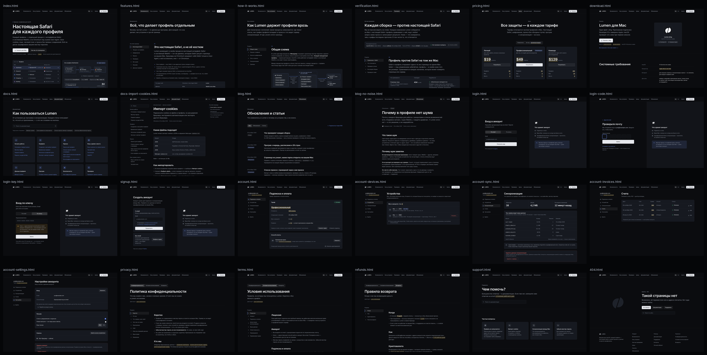

# Сайт: дизайн и прототип

Дизайн сайта продукта: макеты всех страниц, кликабельный прототип, тексты на двух языках и спецификация. **Сайт не разрабатывается и не деплоится**: бэкенда нет, формы никуда не отправляют, поиск не ищет. Всё лежит в `design/site/`; в `Sources/`, `Resources/`, `scripts/`, `.github/` и `Package.swift` нет ни одной правки, остальной `design/` только читается (знак, флаги и иконки берутся из `design/prototypes/kit`).

Рабочее имя — **Lumen**: знак и надпись уже есть в приложении. Домен — заглушка `lumen.example` (зарезервированная зона для примеров). Название и домен — первый из [вопросов](#вопросы--одной-пачкой); меняются одной строкой в `tools/build.mjs`.



## Как смотреть

- **Обзор прототипа:** `design/site/prototype/index.html` — все страницы на русском и английском, снимки, ролики движения и вопросы с кнопкой «Скопировать ответы». Открывается с диска двойным кликом, сеть не нужна. На Mac страницы рисуются настоящим SF Pro.
- **Панель прототипа** внизу каждой страницы: язык, «Отметки решений» (жёлтым подсвечено то, что решаете вы) и «Без движения» (как системное «Уменьшить движение»). На настоящем сайте её не будет.
- **Переходы между страницами** браузер делает только для страниц с сервера: `cd design/site/prototype && python3 -m http.server 8000` → `http://localhost:8000`. Остальное работает и с диска.
- **Снимки:** `shots/{ru,en}/<страница>-{1440,390}.png` — страница целиком, Retina ×2; обзорные листы — `shots/overview-{ru,en}-{1440,390}.png`.
- **Движение:** `shots/motion/*.mp4`, восемь роликов; их список с пояснениями — на странице обзора.
- **Тексты:** `copy/{ru,en}/*.md` — всё, что написано на каждой странице, для чтения; правятся исходники `copy/source/{ru,en}/*.mjs`.
- **Спецификация:** [`spec.md`](spec.md) — токены, контраст, типографика, сетка, компоненты, движение с длительностями.

## Что спроектировано

24 страницы, каждая — на русском и английском, в ширинах 1440 и 390: 96 снимков.

| Страница | Что на ней | Снимок |
|---|---|---|
| Главная | Заголовок «Настоящая Safari для каждого профиля», живая демонстрация (профиль уходит в прокси, затем прогрев со счётчиком cookies), для кого, восемь отличий, цифры проверки, почему без шума, прогрев, что знает сервер | [1440](shots/ru/index-1440.png) · [390](shots/ru/index-390.png) |
| Возможности | Восемь блоков по пунктам продукта с навигацией по разделам: Safari, процесс на профиль, шифрование, прокси, проверка, без шума, прогрев, данные профиля | [1440](shots/ru/features-1440.png) · [390](shots/ru/features-390.png) |
| Как устроено | Для технических читателей: схема процессов, процесс профиля, иерархия ключей, сеть и прокси (каждый канал — как закрыт и чем проверяется), синхронизация, границы | [1440](shots/ru/how-it-works-1440.png) · [390](shots/ru/how-it-works-390.png) |
| Как мы проверяем | Сравнение с Safari на том же Mac, все 14 отличий с причинами, проверки утечек, что проверяется на каждой сборке, как проверить самому, отчёты | [1440](shots/ru/verification-1440.png) · [390](shots/ru/verification-390.png) |
| Цены | Три тарифа (вариант, подсвечен), что входит во все, пробный период, оплата картой и криптовалютой, вход без email, возвраты, вопросы | [1440](shots/ru/pricing-1440.png) · [390](shots/ru/pricing-390.png) |
| Скачать | Требования, установка, подпись и контрольная сумма с командами проверки, первый запуск (экран мастер-пароля с текстами приложения) | [1440](shots/ru/download-1440.png) · [390](shots/ru/download-390.png) |
| Документация | Структура: восемь разделов по возможностям приложения, поиск, частые статьи | [1440](shots/ru/docs-1440.png) · [390](shots/ru/docs-390.png) |
| Документация — статья | Шаблон: дерево, хлебные крошки, оглавление, таблицы, заметки, «Назад / Дальше». Образец — «Импорт cookies» со словами кнопок приложения | [1440](shots/ru/docs-import-cookies-1440.png) · [390](shots/ru/docs-import-cookies-390.png) |
| Обновления | Шаблон списка: фильтр, дата, тип, анонс | [1440](shots/ru/blog-1440.png) · [390](shots/ru/blog-390.png) |
| Обновления — запись | Шаблон записи. Образец — статья «Почему в профиле нет шума» | [1440](shots/ru/blog-no-noise-1440.png) · [390](shots/ru/blog-no-noise-390.png) |
| Вход по email | Одноразовый код; рядом — что хранит аккаунт и «мастер-пароль здесь не вводится» | [1440](shots/ru/login-1440.png) · [390](shots/ru/login-390.png) |
| Вход: код | Шесть ячеек, «отправить ещё раз» без таймера | [1440](shots/ru/login-code-1440.png) · [390](shots/ru/login-code-390.png) |
| Вход по ключу | Лицензионный ключ без email и честное предупреждение: потерян — не восстановить | [1440](shots/ru/login-key-1440.png) · [390](shots/ru/login-key-390.png) |
| Регистрация | С email или без email (оплата криптовалютой → ключ) | [1440](shots/ru/signup-1440.png) · [390](shots/ru/signup-390.png) |
| Кабинет: подписка | Тариф, продление, Mac в аккаунте, способ оплаты | [1440](shots/ru/account-1440.png) · [390](shots/ru/account-390.png) |
| Кабинет: устройства | Mac по коду устройства, отзыв | [1440](shots/ru/account-devices-1440.png) · [390](shots/ru/account-devices-390.png) |
| Кабинет: синхронизация | Ровно то, что видит сервер: непрозрачные объекты, размеры, время; удаление с сервера | [1440](shots/ru/account-sync-1440.png) · [390](shots/ru/account-sync-390.png) |
| Кабинет: счета | Платежи картой и криптовалютой, PDF | [1440](shots/ru/account-invoices-1440.png) · [390](shots/ru/account-invoices-390.png) |
| Кабинет: настройки | Вход, переход на ключ, письма, сеансы, удаление аккаунта | [1440](shots/ru/account-settings-1440.png) · [390](shots/ru/account-settings-390.png) |
| Конфиденциальность | С разделом «Что сервер о вас знает» и прямо: данные профилей сервер расшифровать не может, забытый мастер-пароль не восстанавливается | [1440](shots/ru/privacy-1440.png) · [390](shots/ru/privacy-390.png) |
| Условия | Лицензия, аккаунт, подписка, допустимое использование, ответственность, право | [1440](shots/ru/terms-1440.png) · [390](shots/ru/terms-390.png) |
| Возвраты | Когда, как, криптовалюта, что после | [1440](shots/ru/refunds-1440.png) · [390](shots/ru/refunds-390.png) |
| Поддержка и контакты | Частые вопросы, форма, «никогда не присылайте мастер-пароль», адреса | [1440](shots/ru/support-1440.png) · [390](shots/ru/support-390.png) |
| 404 | Знак, три пути дальше, поиск | [1440](shots/ru/404-1440.png) · [390](shots/ru/404-390.png) |

Английские снимки — те же имена в `shots/en/`.

## Решения и почему

1. **Сайт — ещё одно окно приложения.** Токены из `Theme.swift` один в один, знак и надпись — из `LumenMark.swift` (через `design/prototypes/kit`), шрифт системный. Плоско, без градиентов, свечения, размытия и теней — правило бренда. Отступлений от `Theme.swift` два, оба из ревью дизайна приложения: `textTertiary` `#8A93A3` и `danger` `#EC6F68`, иначе подписи на светлых поверхностях проваливаются ниже 4,5 : 1; оттуда же новый `accentFillStrong` `#4469D6` под белым текстом. Контраст всех 40 пар — в `spec.md`.
2. **Продукт показан собой.** Окно «Профили», лист прогрева, экран мастер-пароля нарисованы на тех же токенах и с теми же строками, что в приложении (`Localizable.strings`). Данные в них — образцы самого приложения из `UISnapshots.swift` (Northwind, прокси в Германии, «Прогрев 4/12 · cookies: 84»), и подпись под демонстрацией это говорит. Окно приложения взято из предложенного ревью вида списка (`design/prototypes/profiles.html`), потому что сайт показывает продукт таким, каким он выйдет.
3. **Главный аргумент — измерение, и оно показано целиком.** Страница «Как мы проверяем» публикует не только «434 из 448», но и все 14 отличий с причинами, разделив их на «в продукте» (6: Apple Pay и Web Push) и «на стенде» (8: язык самотеста, скрытое окно, webdriver). Открытый список отличий убеждает сильнее, чем «100 %».
4. **Без шума — объяснено, а не заявлено.** Три довода: шум противоречит остальным признакам, не доходит до сервера (TLS, HTTP/2, заголовки), а совпадение можно проверить. И честная граница: признаки железа у профилей на одном Mac общие, как у вкладок одной Safari, — профили различаются хранилищем, сетью, языком и часовым поясом. Если такая откровенность на сайте лишняя, её легко убрать, но я бы оставил: покупатель всё равно это узнает.
5. **Позиционирование — приватность и несколько аккаунтов.** Ни слова про обход проверок личности, верификаций и антифрода, слова «антидетект» тоже нет (вопрос 5). В условиях — запрет мошенничества и выдачи себя за другого, а правила сторонних сайтов соблюдает пользователь. `tools/check.mjs` ловит запрещённые формулировки.
6. **Кабинет показывает только то, что знает сервер.** Имён профилей и их числа сервер не знает — по устройству синхронизации, поэтому «профили в синхронизации» — это непрозрачные объекты, размеры и время (вопрос 6). Устройства — по коду, а не по имени: имён Mac сервер тоже не знает. Лимит профилей проверяет приложение, и кабинет так и пишет.
7. **Вход по ключу без email** — для тех, кому не нужен даже email; с честным предупреждением, что потерянный ключ не восстановить.
8. **Все защиты — в каждом тарифе.** Тарифы различаются профилями и устройствами, а не безопасностью. Метка у среднего тарифа — «Рекомендуем», а не «Чаще выбирают»: второе было бы выдумкой.
9. **На сайте нет аналитики** и сторонних скриптов, cookie одна — сеанс кабинета. Это записано в подвале и в политике, то есть обязывает и настоящий сайт.
10. **Движение одноразовое.** Демонстрация на главной проигрывается один раз, когда её видно, и останавливается; всё остальное — появление при прокрутке (240 мс), индикатор раздела (200 мс), смена страниц (200 мс). Ничего не пульсирует, Reduce Motion уважается везде, без JavaScript видно конечное состояние.
11. **Тексты отдельно от вёрстки.** Страницы собираются из `copy/source/{ru,en}` и шаблонов `tools/templates`; читабельные `copy/{ru,en}/*.md` выгружаются из готовых страниц, поэтому тексты и прототип не расходятся. `tools/check.mjs` следит, чтобы у русского и английского были одни и те же ключи.

## Цифры: откуда каждая

Правило брифа — «любая цифра либо правда из репозитория, либо её нет» — проверяется машиной: `copy/facts.mjs` перечисляет каждую цифру сайта с источником, `tools/check.mjs` падает на любой другой. Не считаются только значения, которые решаете вы (жёлтые), образцы данных в макетах (`data-sample`) и код.

Что важно знать о главных цифрах:

- **448 — это признаки страницы-зонда**, сравниваемые с настоящей Safari: в последнем зелёном прогоне CI (#388, коммит `ce64ca1`) — «434 keys identical, 14 differ (reported), 0 must-match keys differ». **TLS и заголовки в эти 448 не входят** — они сравниваются отдельно и сверх них: заголовки запросов 31 из 31, TLS и HTTP/2 15 из 15. В брифе было «по 448 признакам, включая TLS-рукопожатие и порядок HTTP-заголовков» — на сайте я написал, как есть: «448 признаков страницы, заголовки, TLS и HTTP/2».
- **TLS 15 из 15 — из прогона #385** (`d1d1db7`, тот же день). В #388 сервис tls.peet.ws не ответил Safari («JSON Parse error»), и TLS не сравнивался — сравнение «report only» и сборку не роняет. Сайт так и подписывает строку. Это стоит починить до запуска, чтобы цифра бралась из последнего прогона.
- **Самотест 274 проверки, модульных тестов 223, 2 410 пакетов, трасса 606 017 строк** — прогон #388. Это меняется с каждой сборкой: на настоящем сайте цифры должны подставляться из отчёта выпуска (вопрос 7).
- **Остальное** — из кода и документации: Argon2id 64 МиБ / 3 прохода / 4 потока, 26 стран прогрева, 4–12 / 10–35 / 25–90 с на странице, 52 и 90 px панели Safari, macOS 14 из `Info.plist`, 32 МБ для файла cookies, 10 символов мастер-пароля, 10 минут до новой попытки прогрева.

## Что я сознательно не показал

Бриф: «не перечисляй то, что ещё в работе, и не заявляй готовым то, чего нет».

- **WebRTC через SOCKS5-прокси** (пакетный туннель): нужна платная команда Apple Developer, и расширение ещё не запускалось на настоящем Mac. На сайте — честное «в профиле с прокси WebRTC выключен».
- **Профили iPhone и iPad**: меняют только User-Agent, железо остаётся Mac. Показывать это возможностью — значит обещать больше, чем есть.
- **Локальный API автоматизации и `pbctl`**: есть и проверяется самотестом, но в брифе его нет. Могу добавить блок в «Возможности» и раздел в документацию — скажите.
- **Сборка с App Sandbox**: сайт описывает сборку с окном Safari и процессом на профиль; о песочнице App Sandbox на сайте ни слова.

## Что сайт обещает от продукта

Описано так, как выйдет, по брифу. До запуска стоит сверить:

- **Сервер синхронизации и аккаунты.** В репозитории есть клиент и описание API (`docs/SYNC_SERVER_API.md`), а сервера, аккаунтов и выдачи токенов нет.
- **Код устройства** в настройках синхронизации приложения: по нему кабинет показывает Mac, не зная их имён.
- **Аккаунт в приложении** («Настройки → Аккаунт»: где найти лицензионный ключ) и проверка лимита профилей приложением.
- **Подпись Developer ID и нотаризация** выпусков, контрольная сумма на странице «Скачать».

## Вопросы — одной пачкой

С вариантами и кнопкой «Скопировать ответы» — на странице обзора прототипа, раздел «Вопросы». Рекомендуемый вариант первым. Номер вопроса совпадает с жёлтыми отметками на страницах.

1. **Название и домен.** Не фиксирую; ни домены, ни товарные знаки у регистраторов не проверены — только поверхностный поиск.
   - A. **Lumen** — знак и надпись уже готовы. Но так называются несколько приложений для Mac (утилита яркости, Lumen Widgets в Setapp) и телеком Lumen Technologies; нужен домен с приставкой.
   - B. **Cleave** — «рассечь» и «держаться вместе» одновременно, ровно шов знака; браузеров с таким именем не нашёл.
   - C. **Septa** — «перегородки», отсеки; в США это транспортная SEPTA.
   - D. **Kerf** — «пропил», щель разреза; есть зарегистрированный знак KERF в 9-м классе, по-русски тяжело.
   - E. **Seam** — «шов»; занято несколькими продуктами.
   - Рекомендую B или A с доменом-описанием, но только после проверки знаков в 9-м и 42-м классах.
2. **Тарифы.** A (рекомендую): три уровня по профилям — 10 / 50 / 200 профилей, 2 / 3 / 10 Mac, $19 / $49 / $129 в месяц, год — по цене 10 месяцев; в «Команде» 5 мест. B: по местам с безлимитом профилей. C: два уровня. Цифры в макете — только для раскладки, это ваше решение. Для ориентира: по открытым обзорам у конкурентов от ~$10 за 10–20 профилей до ~$300 за 1 000 в месяц ([Octo](https://affmaven.com/octo-browser-pricing/), [Dolphin](https://affninja.com/dolphin-anty-pricing/), [сводка](https://fleetproxy.io/blog/anti-detect-browsers)); обзоры расходятся, сверять по сайтам. Ещё: валюта ($, ₽ или обе) и что приложение умеет без подписки (в макете — открывает профили только для экспорта).
3. **Пробный период.** A (рекомендую): 7 дней без карты, все возможности, до 3 профилей. B: бесплатный тариф навсегда на 2–3 профиля. C: без пробного, только возврат.
4. **Английская версия.** A (рекомендую): на старте — всё уже написано и свёрстано, нужна вычитка носителем. B: позже, переключатель языка скрыт.
5. **Слово «антидетект».** A (рекомендую): не использовать нигде. B: только в метаданных. C: в текстах.
6. **Синхронизация в кабинете.** A (рекомендую): только то, что знает сервер, как в макете. B: расшифровывать в браузере мастер-паролем — ломает обещание «мастер-пароль не покидает Mac».
7. **Отчёты проверок на сайте.** A (рекомендую): публиковать JSON сравнения и проверок с каждым выпуском (без логов CI и путей машины сборки). B: только цифры.
8. **Приём оплаты.** A (рекомендую): страница оплаты провайдера — номер карты к нам не попадает, так и написано в политике; криптовалюта через процессинг (какие монеты и сети — ваше решение). B: форма на нашем сайте — тогда переписывать политику и проходить PCI DSS. И — какой провайдер карт.
9. **Компания и реквизиты** (факты): название, страна, адрес; почтовый сервис и хостинг; сроки хранения журналов и переписки; срок ответа поддержки; применимое право. Правовые тексты — черновики для юриста.
10. **Возвраты.** A (рекомендую): 14 дней без вопросов и 7 дней после продления, если новым периодом не пользовались. B: 30 дней. C: без возвратов.
11. **Данные выпуска** (факты): минимальная macOS для окна Safari (в `Info.plist` 14.0, режим проверялся на macOS 26 и 27), процессоры (Apple silicon, Intel или оба), версия и размер файла, Team ID, SHA-256.

## Где прототип расходится с реальностью

- **Шрифт.** PNG сняты в Chromium на Linux: вместо SF Pro — Inter, вместо SF Mono — DejaVu Sans Mono. Русские строки в SF Pro чуть уже; окончательные переносы видно в Safari на Mac.
- **Интерфейс приложения** на страницах — нарисованная копия на тех же токенах, а не снимок; размеры контролов у настоящих AppKit немного другие.
- **Формы, поиск, оплата** ничего не делают; ссылки на все статьи документации ведут на один шаблон.
- **Ролики** записаны около 25 кадров в секунду: движение видно, кривые лучше смотреть в самом прототипе.
- **Снимки без потерь** — 96 PNG ≈ 69 МБ. Палитровое сжатие уменьшало их втрое, но сдвигало цвета (выбранная строка теряла синий оттенок), а для макета точность токенов важнее.

## Как пересобрать

Нужны Node 22 и Playwright с Chromium, для роликов ещё ffmpeg, для обзорных листов — Python с Pillow. Сеть не нужна: рендер и запись обрывают любой запрос не к файлам прототипа.

```bash
node design/site/tools/build.mjs        # страницы → prototype/{ru,en}, обзор → prototype/index.html
node design/site/tools/check.mjs        # сеть, ru/en, ссылки, цифры, формулировки, ширина телефона
node design/site/tools/contrast.mjs     # контраст всех пар цветов
node design/site/tools/export-copy.mjs  # тексты → copy/{ru,en}/*.md
node design/site/tools/render.mjs       # снимки → shots/{ru,en}/*.png (или: render.mjs pricing)
node design/site/tools/record.mjs       # ролики → shots/motion/*.mp4
python3 design/site/tools/overview.py   # обзорные листы → shots/overview-*.png
```

## Что где лежит

```text
design/site/
  README.md          этот файл
  spec.md            токены, контраст, типографика, сетка, компоненты, движение
  prototype/
    index.html       обзор: страницы, снимки, ролики, вопросы
    ru/, en/         24 страницы на каждом языке
    assets/          site.css, site.js — вся вёрстка и поведение
  shots/
    ru/, en/         <страница>-1440.png, <страница>-390.png
    motion/          ролики движения, MP4
    overview-*.png   все страницы на одном листе
  copy/
    ru/, en/         тексты страниц для чтения (выгружаются из прототипа)
    source/ru, en/   исходники текстов, из которых собираются страницы
    facts.mjs        каждая цифра сайта и её источник
  tools/             сборка, проверки, рендер, запись, шаблоны страниц, вопросы
```
